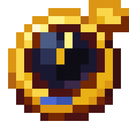
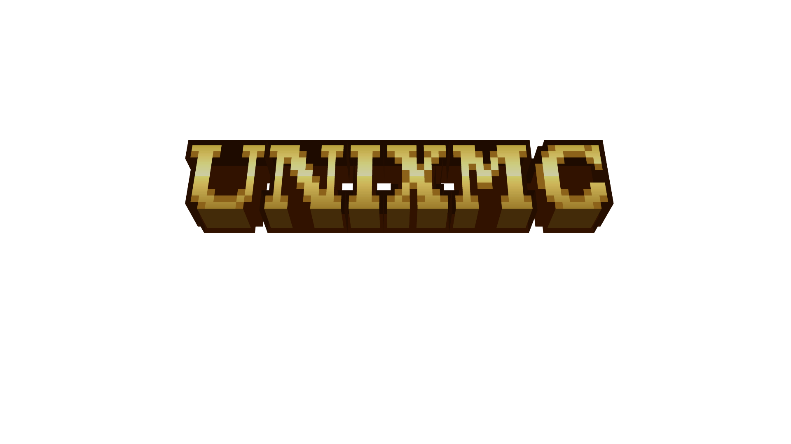
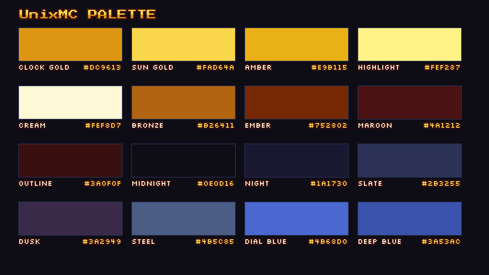

<div align="center">



# UnixMC Brand Kit

**The official logos, colours, fonts and usage rules for UnixMC – the Java + Bedrock Minecraft server.**

`play.unixmc.com`

[](LICENSE)
[](CHANGELOG.md)
[](licenses/third-party)

</div>



---

## Start here

| I want to… | Go to |
|---|---|
| Use the UnixMC logo, avatar or banner | [`logo/`](logo) · [`avatar/`](avatar) · [`banner/`](banner) · [`socials/`](socials) |
| Find the right file or size | [Asset Index](docs/ASSET_INDEX.md) |
| Know the brand rules (logo, colour, type, do/don't) | [Brand Guidelines](docs/BRAND_GUIDELINES.md) |
| Know **what I'm allowed to do** with the assets | [Usage Policy](docs/USAGE_POLICY.md) |
| Understand the licence of every file | [Licensing](docs/LICENSING.md) |
| Grab colours (CSS / JSON / GIMP / Lospec) | [`colors/`](colors) |
| See the colours the website actually uses | [Website UI palette](colors/website-ui/README.md) |
| Ask for permission or report misuse | [Contact](#contact) |

## What's inside

```
unixmc-brandkit/
├── README.md              ← you are here
├── LICENSE                ← CC BY-NC-ND 4.0 (full legal code)
├── NOTICE.md              ← copyright, trademarks, third-party notices
├── CHANGELOG.md
├── MANIFEST.sha256        ← checksums for integrity checks
├── logo/                  ← the Clock at 16–2048 px, animated GIF
│   └── characters/        ← cartoon, mentor, moderation and staff badges
├── banner/                ← 3D title renders, edition titles, Blockbench model
├── avatar/                ← square avatars, 320–1000 px (used on every platform)
├── socials/               ← platform banners, headers, covers
│   └── youtube/  instagram/  x/  bluesky/
├── colors/                ← palette sheet, CSS/JSON/GPL/HEX, website UI palette
├── fonts/                 ← Press Start 2P, Silkscreen
├── source/                ← original/source images
├── docs/
│   ├── BRAND_GUIDELINES.md  ← the full brand overview
│   ├── USAGE_POLICY.md      ← permitted / not permitted / how to ask
│   ├── LICENSING.md         ← licence matrix for every asset
│   └── ASSET_INDEX.md       ← every file and which size to use
└── licenses/third-party/  ← SIL OFL texts for the bundled fonts
```

## The brand at a glance

<table>
<tr>
<td width="50%" valign="top">

**Name** – `UnixMC` (capital **U**, **M**, **C**). Server address is always lowercase: `play.unixmc.com`.

**Mark** – a 16 × 16 pixel-art gold pocket watch ("the Clock") with a night-blue face and a blue jewel.

**Wordmark** – the 3D gold block-letter title in [`banner/`](banner).

**Typefaces** – [Press Start 2P](fonts) for display, [Silkscreen](fonts) for labels.

</td>
<td width="50%" valign="top">



</td>
</tr>
</table>

Core colours: **Clock Gold** `#DC9613` · **Sun Gold** `#FAD64A` · **Cream** `#FEF8D7` · **Midnight** `#0E0D16` · **Night** `#1A1730` · **Dial Blue** `#4B68D0`. Full palette and contrast data in the [guidelines](docs/BRAND_GUIDELINES.md#4-colour).

## Quick licence summary

> These are **not** open-source or public-domain assets. They are © UnixMC, released under
> [**Creative Commons Attribution-NonCommercial-NoDerivatives 4.0**](https://creativecommons.org/licenses/by-nc-nd/4.0/).

| ✅ You may | ❌ You may not |
|---|---|
| Share the **unmodified** files with attribution | Sell them or use them commercially |
| Scale proportionally, convert format, place on a plain background | Edit, recolour, redraw, remix or add effects |
| Reference UnixMC in articles, listings, videos and fan content (non-commercial) | Imply endorsement, or use the mark for another server/brand |
| | Use the name or logo in a way that confuses people about who is behind it |

The licence covers **copyright only**. The UnixMC name and logo are also brand identifiers; see the [Usage Policy](docs/USAGE_POLICY.md). The bundled **fonts keep their own SIL Open Font License**; see [Licensing](docs/LICENSING.md).

UnixMC is **not an official Minecraft product** and is not approved by or associated with Mojang Studios or Microsoft. See [NOTICE](NOTICE.md).

## Contact

For permission requests, partnership or sponsor use, or to report misuse of the brand, open an issue at
[github.com/UnixMC-Project/Brand-Kit/issues](https://github.com/UnixMC-Project/Brand-Kit/issues) or contact the UnixMC team in-game at `play.unixmc.com`.

---

<sub>© UnixMC. Brand assets licensed CC BY-NC-ND 4.0 · fonts under SIL OFL 1.1 · "Minecraft" is a trademark of Mojang Synergies AB.</sub>
