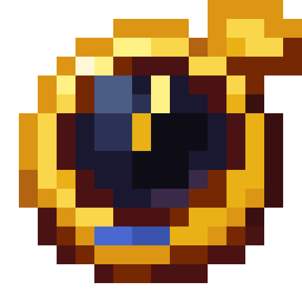
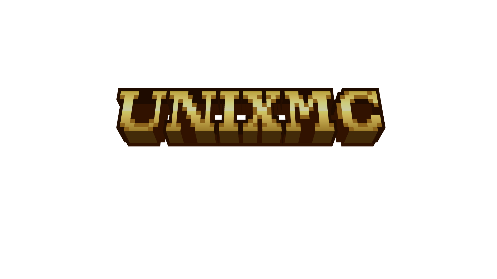
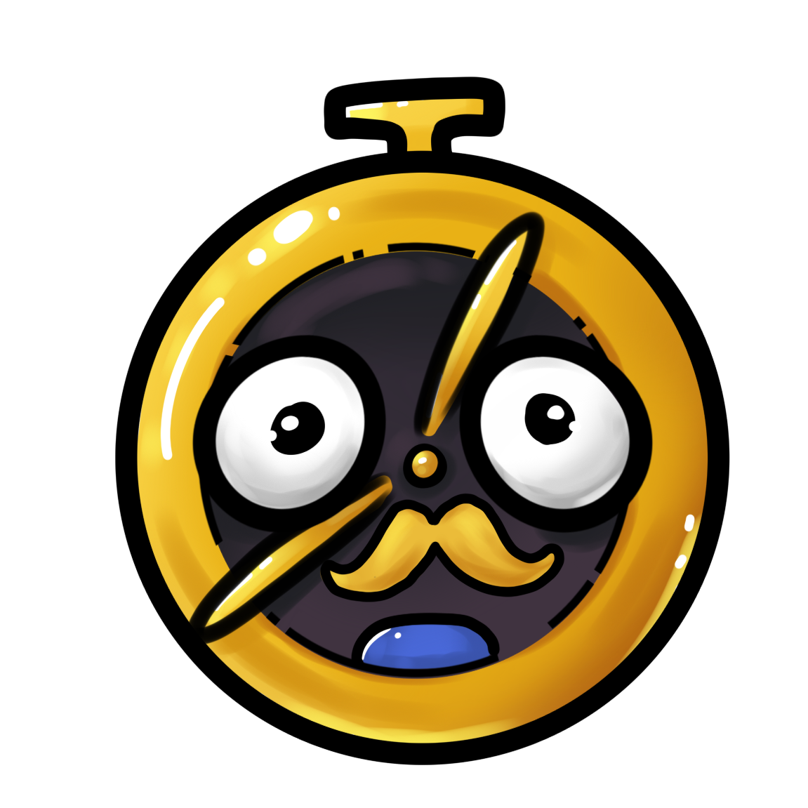
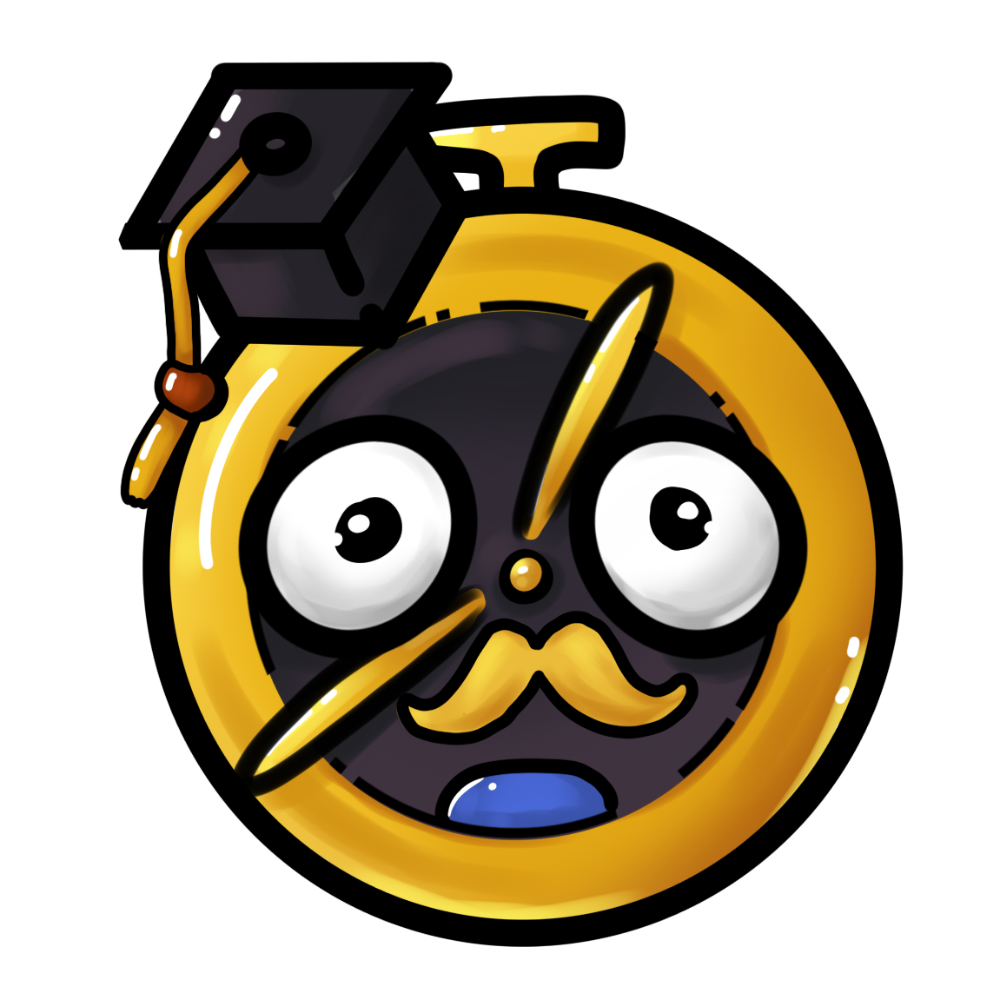
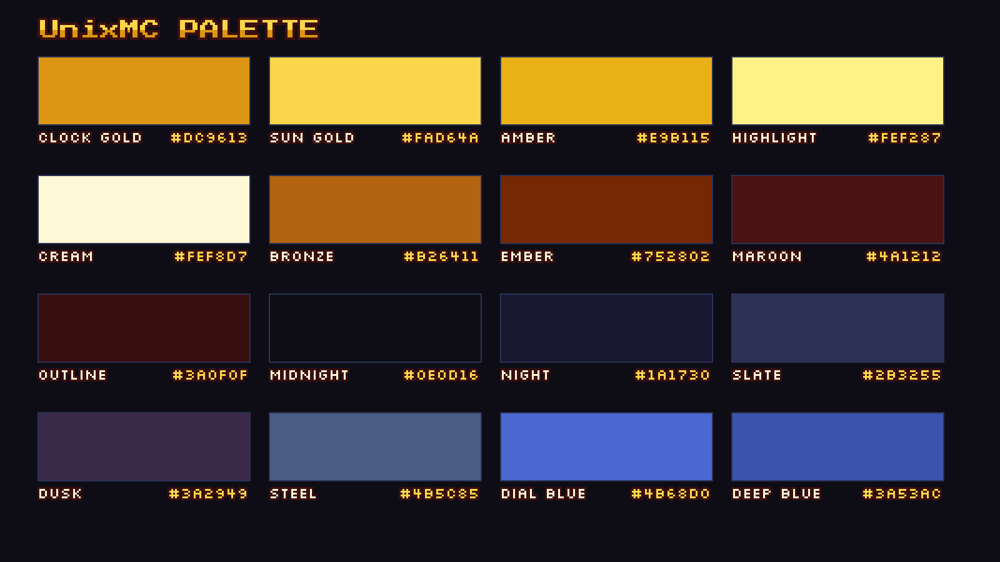

# UnixMC Brand Guidelines

*Kit version 2.0.0 · applies to every file in this repository*

This is the single overview of the UnixMC brand: who we are, what the logos are, how to use colour and type, and how to avoid getting it wrong. For what you are *legally* allowed to do with the files, read the [Usage Policy](USAGE_POLICY.md) and [Licensing](LICENSING.md).

**Contents**
1. [Brand overview](#1-brand-overview)
2. [Name and wording](#2-name-and-wording)
3. [Logo system](#3-logo-system)
4. [Colour](#4-colour)
5. [Typography](#5-typography)
6. [Backgrounds and imagery](#6-backgrounds-and-imagery)
7. [Do and don't](#7-do-and-dont)
8. [Platform asset reference](#8-platform-asset-reference)
9. [File naming and versioning](#9-file-naming-and-versioning)

---

## 1. Brand overview

UnixMC is a **Java + Bedrock Minecraft server** (`play.unixmc.com`). The identity is built around two ideas:

- **The Clock** – a gold pocket watch with a dark night-blue face. It is the mark; it appears on every avatar and favicon-sized surface.
- **Pixel craft** – everything is drawn on a visible pixel grid, in warm golds on deep night-blues, the way the in-game world looks. Nothing in the brand should be smooth, glossy or photo-real except the in-game screenshots themselves.

Tone of the visuals: warm, handmade, a little mysterious. Gold is the light; night-blue is the world.

## 2. Name and wording

| Use | Write | Never write |
|---|---|---|
| Brand name | **UnixMC** | Unixmc, UNIXMC¹, Unix MC, Unix-MC, UnixMc |
| Server address | `play.unixmc.com` (lowercase) | Play.UnixMC.com |
| Descriptor | **Java + Bedrock Server** | Java/Bedrock server, JE+BE |

¹ The 3D title logo is drawn in capitals; that is a *logo*, not a spelling. In running text always write **UnixMC**.

- Do not translate or abbreviate the name ("UMC", "Unix").
- Do not use "UnixMC" as part of another name, domain, handle or server title without written permission.
- Always describe the server accurately. UnixMC is **not** an official Minecraft product (see [NOTICE](../NOTICE.md)).

## 3. Logo system

### 3.1 Primary mark – the Clock



| | |
|---|---|
| Files | [`logo/`](../logo) |
| Native grid | **16 × 16 px** (`unixmc_logo_native_16x16.png`) |
| Provided sizes | 16 (native), 64, 128, 256, 512, 1024, 2048 px, transparent background |
| Source | [`logo/Clock512.png`](../logo/Clock512.png) (512 px original), animated version in [`logo/Clock512.gif`](../logo/Clock512.gif) |

**Scaling rule (important).** Every size is the 16 × 16 original enlarged by a whole-number factor with **nearest-neighbour** scaling (64 = ×4, 128 = ×8, 256 = ×16, 512 = ×32, 1024 = ×64, 2048 = ×128). Always pick the provided size closest to your need, and if you must scale yourself:

- use whole-number multiples of 16 px where possible,
- turn **off** smoothing / bilinear / bicubic (CSS: `image-rendering: pixelated;`),
- never stretch, rotate, skew or blur.

**Minimum size:** 16 px (native). Below 32 px the clock reads as a gold ring with a dark centre – that is acceptable only for favicons and tiny UI.

**Clear space:** keep at least **⅛ of the logo's width** free of other elements on every side.

### 3.2 Wordmark – the 3D title



The 3D gold block-letter "UNIXMC" title lives in [`banner/`](../banner). It is a render of the Blockbench model [`title_model.bbmodel`](../banner/title_model.bbmodel).

| File | Purpose |
|---|---|
| `unixmc_title.png` | Standard title (1920 × 1080) |
| `unixmc_title_alpha.png` / `_beta.png` / `_release.png` | Edition titles with the phase tag |
| `unixmc_title_lostsoul.png` | "Lost Souls" season/edition title |
| `unixmc_banner_big.png` | Compact wide banner crop (802 × 177) |

Use the title **as supplied**. Do not re-typeset it in a font, and do not swap the tag plate for text of your own.

### 3.3 Lockup – mark + name

For social headers the Clock sits **left** of the name, aligned to the name's cap-height midline, followed by the descriptor line and the server address in a bordered box. The reference lockup is in [`youtube_banner_2560x1440_branded.png`](../socials/youtube/youtube_banner_2560x1440_branded.png). Do not rebuild lockups from scratch; use the supplied files.

### 3.4 Secondary marks – character and staff badges

| | | |
|---|---|---|
|  |  |  |
| `logo_cartoon.png` – the Clock as a character; community/casual use | `logo_mentor.png` – mentor role (graduation cap) | `logo_moderation.png` – moderation role |

`logo/characters/kawaii_logo.webp` is the small "STAFF" chibi variant used for staff badges.

Rules for secondary marks:
- They **never replace** the primary mark on official surfaces (avatars, banners, store, website header).
- They are used for roles, emotes, in-community badges and informal content.
- Do not create new role variants (hats, items, expressions) without approval; this keeps the roles recognisable.

### 3.5 Avatars

Square, mark centred, on the blurred in-game backdrop. Provided in [`avatar/`](../avatar) at 320, 400, 800 and 1000 px; see the [Asset Index](ASSET_INDEX.md#which-avatar-goes-where) for which size each platform uses. They are all the same artwork at different sizes; use the exact size your platform asks for. Platforms crop to a circle, so nothing important lives in the corners.

## 4. Colour

UnixMC has **two palettes**. They share the gold/night DNA but serve different jobs:

| Palette | Where | Source of truth |
|---|---|---|
| **Brand palette** (16 colours, sampled from the Clock) | logo, graphics, social, print, video | this page · [`colors/`](../colors) |
| **Website UI palette** (themes *Overworld* light / *The End* dark) | unixmc.com interface only | [`colors/website-ui/`](../colors/website-ui/README.md) |



### 4.1 Brand palette

| Group | Name | Hex | RGB | Role |
|---|---|---|---|---|
| **Gold** | Clock Gold | `#DC9613` | 220 150 19 | **Primary brand colour**; clock rim, main accent |
| | Sun Gold | `#FAD64A` | 250 214 74 | Light gold; highlights, headings on dark |
| | Amber | `#E9B115` | 233 177 21 | Mid gold; shading |
| | Highlight | `#FEF287` | 254 242 135 | Glints and specular points |
| | Cream | `#FEF8D7` | 254 248 215 | Lightest tone; text on dark, light backgrounds |
| **Warm** | Bronze | `#B26411` | 178 100 17 | Dark gold, borders |
| | Ember | `#752802` | 117 40 2 | Title extrusion, depth |
| | Maroon | `#4A1212` | 74 18 18 | Outline-weight warm dark |
| | Outline | `#3A0F0F` | 58 15 15 | Pixel outline, darkest warm |
| **Night** | Midnight | `#0E0D16` | 14 13 22 | **Primary dark background**; the clock face |
| | Night | `#1A1730` | 26 23 48 | Panels on Midnight |
| | Slate | `#2B3255` | 43 50 85 | Cards, dark blue surfaces |
| | Dusk | `#3A2949` | 58 41 73 | Purple-grey shadow |
| **Blue** | Steel | `#4B5C85` | 75 92 133 | Muted blue; glass reflection |
| | Dial Blue | `#4B68D0` | 75 104 208 | **Bright accent**; the jewel on the Clock |
| | Deep Blue | `#3A53AC` | 58 83 172 | Dark blue accent |

**Proportions** (a guide, not a rule): ~60 % Night group (backgrounds) · ~30 % Gold group (type, logo, key UI) · ~8 % Warm group (outlines, depth) · ~2 % Blue group (single accent points).

**Rules**
- Gold on night is the signature pairing. Gold on light backgrounds is allowed only with a Warm-group outline (the logo already has one).
- Use **Dial Blue** sparingly: one accent per layout (a button, a gem, a link).
- Do not introduce new brand colours. If you need a state colour (error, success), use the Website UI palette tokens.
- Do not use gradients across the gold group on flat graphics; the pixel look relies on hard-edged steps.

### 4.2 Accessible pairings (WCAG 2.1 contrast)

Contrast ratios were computed from the hex values.

| Text | Background | Ratio | Result |
|---|---|---|---|
| Cream `#FEF8D7` | Midnight `#0E0D16` | **18.04 : 1** | AAA |
| Cream `#FEF8D7` | Night `#1A1730` | 16.23 : 1 | AAA |
| Cream `#FEF8D7` | Slate `#2B3255` | 11.61 : 1 | AAA |
| Sun Gold `#FAD64A` | Midnight `#0E0D16` | 13.59 : 1 | AAA |
| Sun Gold `#FAD64A` | Night `#1A1730` | 12.23 : 1 | AAA |
| Clock Gold `#DC9613` | Midnight `#0E0D16` | 7.74 : 1 | AAA |
| Clock Gold `#DC9613` | Night `#1A1730` | 6.96 : 1 | AA |
| Midnight `#0E0D16` | Clock Gold `#DC9613` | 7.74 : 1 | AAA (text on gold button) |
| Outline `#3A0F0F` | Sun Gold `#FAD64A` | 11.78 : 1 | AAA |
| Outline `#3A0F0F` | Cream `#FEF8D7` | 15.63 : 1 | AAA (text on light) |
| Ember `#752802` | Cream `#FEF8D7` | 9.52 : 1 | AAA |
| Cream `#FEF8D7` | Deep Blue `#3A53AC` | 6.51 : 1 | AA |
| Dial Blue `#4B68D0` | Midnight `#0E0D16` | 3.85 : 1 | Large text / graphics only |
| Dial Blue `#4B68D0` | Night `#1A1730` | 3.47 : 1 | Large text / graphics only |

**Avoid:** Dial Blue for body text on dark; gold on Cream (insufficient contrast); Steel on Night.

### 4.3 Machine-readable palette

All in [`colors/`](../colors):

| File | Use it for |
|---|---|
| `unixmc_palette.css` | CSS custom properties (`--unixmc-clock-gold`, …) |
| `unixmc_palette.json` | Design tooling, build scripts (name, id, hex, rgb, group, role) |
| `unixmc_palette.gpl` | GIMP, Krita, Aseprite (import palette) |
| `unixmc_palette.hex` | Lospec / Pixelorama / generic hex-list import |
| `unixmc_colors.txt` | Original plain-text list (kept for compatibility) |
| `unixmc_palette.png` | Visual reference swatch sheet |
| `website-ui/` | The unixmc.com UI token audit (see §4.4) |

```css
:root {
  --unixmc-clock-gold: #dc9613; --unixmc-sun-gold: #fad64a;
  --unixmc-amber: #e9b115;      --unixmc-highlight: #fef287;
  --unixmc-cream: #fef8d7;      --unixmc-bronze: #b26411;
  --unixmc-ember: #752802;      --unixmc-maroon: #4a1212;
  --unixmc-outline: #3a0f0f;    --unixmc-midnight: #0e0d16;
  --unixmc-night: #1a1730;      --unixmc-slate: #2b3255;
  --unixmc-dusk: #3a2949;       --unixmc-steel: #4b5c85;
  --unixmc-dial-blue: #4b68d0;  --unixmc-deep-blue: #3a53ac;
}
```

> **Naming change:** the original `unixmc_colors.txt` used `--unixmc-gold`, `--unixmc-blue`, … The new `unixmc_palette.css` uses the full colour name (`--unixmc-clock-gold`, `--unixmc-dial-blue`, …). The old file is untouched.

### 4.4 Website UI palette (unixmc.com)

The website runs two themes defined in one token file:

| Token | **Overworld** (light) | **The End** (dark) | Role |
|---|---|---|---|
| `--brand-ground` | `#F4EDDC` | `#14101F` | Page background |
| `--brand-surface` | `#FBF7EC` | `#1C1729` | Cards, panels |
| `--brand-ink` | `#33352B` | `#ECE6F8` | Body text |
| `--brand-edge` | `#D8CCAE` | `#352B4A` | 3 px pixel borders |
| `--brand-edge-deep` | `#A89B7D` | `#0C0914` | Offset block shadow |
| `--brand-gold` | `#FFAA00` | `#FFBF47` | Signature accent: buttons, focus |
| `--brand-gold-deep` | `#835700` | `#D99A1C` | Accent text, warnings |
| `--brand-leaf` | `#4C6743` | `#C39BF0` | Secondary accent, headings |
| `--brand-link` | `#9C4A00` | `#FFB347` | Links |

The website's gold (`#FFAA00` / `#FFBF47`) is Minecraft's in-game gold text colour and intentionally differs slightly from the logo's **Clock Gold** `#DC9613`. For graphics and print use the brand palette; for the web interface use the tokens above. The full list of all 489 colours in use, with roles, modes and counts, plus a list of near-duplicates to consolidate, is in [`website-ui/README.md`](../colors/website-ui/README.md).

## 5. Typography

| | Press Start 2P | Silkscreen |
|---|---|---|
| Role | **Display** – titles, headings, big numbers, short slogans | **Label** – small caps text, tags, captions, swatch labels, UI chips |
| Style | Bold 8-bit arcade capitals | Compact pixel caps, lighter weight |
| Files | `fonts/PressStart2P-Regular.ttf` | `fonts/Silkscreen-Regular.ttf` |
| Licence | SIL OFL 1.1 · © 2012 The Press Start 2P Project Authors | SIL OFL 1.1 · © 2001 The Silkscreen Project Authors |
| Source | [fonts.google.com/specimen/Press+Start+2P](https://fonts.google.com/specimen/Press+Start+2P) | [fonts.google.com/specimen/Silkscreen](https://fonts.google.com/specimen/Silkscreen) |

**Rules**
- Pixel fonts are for **short text only**: headings, labels, one-line slogans. For paragraphs use a clean, legible system or sans-serif font.
- Set pixel fonts at **multiples of 8 px** (8, 16, 24, 32, …) and turn font smoothing off in graphics tools so edges stay crisp.
- Press Start 2P is naturally wide: keep headings short, line-height ≥ 1.4, no all-caps paragraphs.
- Colour: Sun Gold or Cream on Midnight/Night. A 1–2 px Maroon/Outline drop-shadow (offset right-down) gives the "block" look.
- Do not substitute a "similar" pixel font. If the fonts are unavailable, use a monospace fallback in layouts and fix it when possible.

```css
@font-face { font-family: "Press Start 2P"; src: url("PressStart2P-Regular.ttf") format("truetype"); font-display: swap; }
@font-face { font-family: "Silkscreen";     src: url("Silkscreen-Regular.ttf")     format("truetype"); font-display: swap; }
.unixmc-heading { font-family: "Press Start 2P", monospace; color: var(--unixmc-sun-gold); text-shadow: 2px 2px 0 var(--unixmc-outline); }
.unixmc-label   { font-family: "Silkscreen", monospace;     color: var(--unixmc-cream);    letter-spacing: .08em; text-transform: uppercase; }
```

When you redistribute the fonts you must include their licence file; include the `OFL_*.txt` files from [`licenses/third-party/`](../licenses/third-party). See [Licensing](LICENSING.md#fonts).

## 6. Backgrounds and imagery

- **Dark first.** The default surface is Midnight → Night (the Instagram highlight cover shows the standard soft radial gradient).
- **In-game imagery.** Social banners use UnixMC world screenshots, extended with a blur where the platform ratio needs more canvas (see the YouTube banner). Keep the lockup inside the platform safe area.
- **Light backgrounds.** The Clock's Maroon outline carries it on Cream and white; it can also sit on photos with sufficient contrast. Avoid busy mid-tone backgrounds directly behind the mark.
- **Shadows.** Use a hard-edged pixel offset shadow (no Gaussian blur) for the pixel look.
- **Screenshots** must be game-accurate: no mods that misrepresent the server, no other servers' builds.

## 7. Do and don't

| ✅ Do | ❌ Don't |
|---|---|
| Use the files provided in this kit | Redraw, trace or "clean up" the logo |
| Scale in whole-number steps, nearest-neighbour | Stretch, squash, rotate, blur or smooth-scale |
| Keep ⅛-width clear space | Crowd the mark with text, borders or other logos |
| Use Cream/Gold on Midnight/Night | Recolour the logo, add gradients, glows, bevels or outlines |
| Credit: "UnixMC logo © UnixMC (CC BY-NC-ND 4.0)" where space allows | Remove or hide the copyright/attribution requirement |
| Write **UnixMC** | Write "Unixmc", "Unix MC", "UNIXMC" in body text |
| Make clear UnixMC is independent of Mojang/Microsoft | Use Minecraft's logo or branding as though part of UnixMC |
| Ask first for anything commercial | Put the logo on merch, sponsor packs, ads or other servers without written consent |

## 8. Platform asset reference

| Platform | File | Size | Notes |
|---|---|---|---|
| YouTube | `avatar/unixmc_avatar_800x800.png` | 800 × 800 | Channel icon |
| | `youtube_banner_2560x1440.png` | 2560 × 1440 | Clean banner (no lockup) |
| | `youtube_banner_2560x1440_branded.png` | 2560 × 1440 | With lockup; keep lockup within the centre safe area (≈ 1546 × 423) |
| | `youtube_watermark_150x150.png` | 150 × 150 | Video watermark |
| Instagram | `avatar/unixmc_avatar_320x320.png` | 320 × 320 | Profile picture |
| | `instagram_highlight_cover_1080x1920.png` | 1080 × 1920 | Story highlight cover; the mark is centred (crops to a circle) |
| TikTok | `avatar/unixmc_avatar_400x400.png` | 400 × 400 | Profile photo |
| X | `avatar/unixmc_avatar_400x400.png` | 400 × 400 | Profile picture |
| | `x_header_1500x500.png` | 1500 × 500 | Header; the left/bottom area is covered by the avatar |
| Bluesky | `avatar/unixmc_avatar_1000x1000.png` | 1000 × 1000 | Avatar |
| | `bluesky_banner_1500x500.webp` | 1500 × 500 | Banner (WebP) |

Platform specs change; check the current requirements before uploading and prefer the largest provided size, since platforms re-compress.

## 9. File naming and versioning

- Files: `unixmc_<asset>_<WxH>.<ext>` in lowercase with underscores; platform files are prefixed with the platform (`x_`, `youtube_`, …).
- Never rename an asset when sharing it; keep the original filename.
- Kit versions follow semantic-style numbering (`MAJOR.MINOR.PATCH`) listed in the [CHANGELOG](../CHANGELOG.md). A **major** version = the identity changed; **minor** = assets added; **patch** = fixes.
- `MANIFEST.sha256` (repository root) lists a checksum for every asset file so you can confirm yours is unmodified:
  `sha256sum -c MANIFEST.sha256`.
